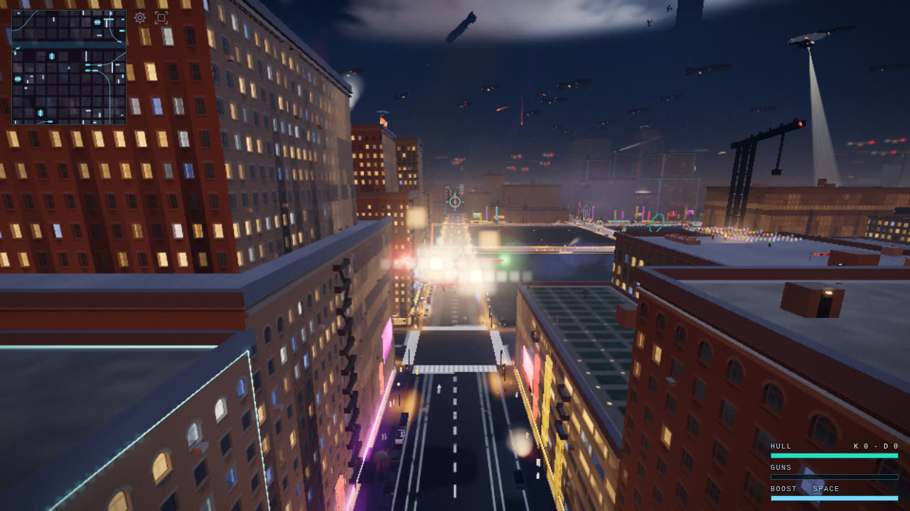

# The Infinite War

The Infinite War goal (Z1, SKY1, C1, P1, R1, then O1's gate) turns the 2 km
torus into a city at war with no edge and no end. A sky full of airships,
dogfights and flak runs to the horizon. Towers come down around a pilot who
flies low, and comets and burning wrecks tear through whole rows. A real
city stands under all of it, and only the parts you can touch are
simulated.

This page explains how the illusion is built, what it may cost, and which
knobs tune it.

## The three layers

Everything on screen belongs to exactly one layer. Each layer is cheaper
than the one before it, and each one only starts where the one before it
can no longer be seen.

| layer | what is in it | how it moves | costs | can you touch it? |
| --- | --- | --- | --- | --- |
| **Real** | the city and its destruction, the 20-ship airship fleet, planes, the E1 air force (hundreds of enemy planes: aces and squadrons), flak, bombs, comets, meteors, wrecks, C1's low chaos | server-authoritative; every pose is a pure function of wire state and synced server time | CPU (server sim, client posing) and the wire | yes: what is drawn is what collides (draw == collide) |
| **Cosmetic** | SKY1's armada (640 airship slots), distant dogfights (120 groups) and their flak (160) | a pure function of (seed, synced clock, unwrapped camera offset), evaluated per vertex in the shader from `gl_InstanceID` | four draws, no per-object CPU, nothing on the wire | no: it is never nearer than `SKY_INNER` (900 m), beyond the far plane |
| **Painted** | R1's far city (L2's two meshes: the lit street carpet and the instanced far towers, 0.8–5 km), the sky dome, the cloud deck, the city glow | world-anchored lattice in the far shell; the dome is a shader | a handful of draws | no |

### Where one layer hands off to the next

The hand-offs are distances, and the fog hides each one.

- **Real → painted, at 800 m.** The real city is fully fogged at
  `FOG_DISTANCE` (800 m) and the camera's far plane is 900 m. The far
  shell draws every far vertex along its own view ray at a compressed depth
  just inside the fog limit (`far-skyline.ts`), so real geometry at 800 m or
  more is exactly the fog colour and always loses the depth test to it. A
  torus wrap can therefore never show against the far city. Far towers fade
  to the glow-aware fog colour (`fog.ts abGlowFog`) and then sink while
  already fog-coloured. Nothing pops.
- **Real → cosmetic, at 900–1500 m.** A cosmetic airship's visibility is
  exactly 0 nearer than `SKY_INNER` and ramps in over `SHIP_FADE_IN`
  (950–1500 m), while the real fleet is fully fogged by 800 m. A real ship
  and a cosmetic one are never both visible in the same place. The real
  fleet's bands (K1: the two street layers at 86–176 m and the rooftops at
  about 241–400 m) sit inside the armada's layers (150–410 m), so the sky
  reads as one fleet that thins into the haze, down among the far towers. A new real ship comes on at least
  `FLEET_HIDE_M` (900 m) from every human, so it drifts out of the haze
  rather than appearing.
- **Cosmetic → painted.** Both live in L2's far shell and share its haze
  (`SKY_VIS` / `SKY_HAZE`, the same shape as the far city's 0.7 / 4000), so
  the armada sinks into the same air as the skyline.

`concepts/invariants/sky-meets-fog.md` lists every site that must agree on
the fog. A custom shader that fogs itself must call `abFogFactor`, or it
becomes the one thing that pops at 800 m.

### The invariants every layer keeps

- **Draw == collide.** If you can hit it, it is drawn exactly where the
  crash check sees it: the city's chunks, the debris on the render clock,
  the fleet's hull table (`BOSS_PARTS`), and the P1 tunnels, which break on
  every client at their entry times.
- **Determinism.** The server sends events and the clients pose them on
  the synced clock, so a late joiner sees the same war.
- **The HDR emissive ladder.** Bloom starts at 0.72. Dressing (embers,
  room lights, rubble glow, cosmetic lights) stays under it, and only the
  rungs that should bloom go over.
- **Zero per-frame allocation in hot paths.** `tools/chaos-bench.ts`,
  `tools/spectacle-bench.ts` and `tools/destruction-bench.ts` hold every
  entry point to 1 KB/frame and the whole frame to 4 KB.

## The war in the streets (K1)

The sky is lowered onto the skyline. The cloud deck is at `CLOUD_BASE`
(440 m) and the soft ceiling at 480 m, so the four landmark spires pierce
the deck and the playable air is the skyline itself. The real fleet flies
three layers, each with one heading:

- **The x-avenues and the z-avenues.** Pickets and cruisers run below the
  roofline, their beams inside the avenue's lot lines. Their searchlights
  swing abeam onto the facades.
- **The rooftops.** Carriers and two cruisers skim mid-block lines. Each
  lane's altitude is a profile that keeps 20 m over every roof under it
  and eases up and down at no more than a 0.2 slope.

`common/src/fleetplan.ts` fits every lane to the city (`laneClearance`):
the buildings' solids and roof structures, the bridges, piers and
viaducts, the cranes, the aircraft and the props. Both sides install the
same plan (`installFleetPlan(planFleet(…))`).

Only a tower crane may stand in a lane's way. It is a **planned
break-through**: the server finds the instant the hull would meet it on
the ship's own course (`breakTouchIn`) and fells it 250 ms before. A P1
sweep carries the impact on from the nose, and the ship takes 12 % of
its HP.

A street ship that is shot down falls along its avenue, and its landing
ploughs both facades (P1 flank sweeps).

The sky traffic came down too:

- helicopters fly at 192–222 m, between the street layers and the
  rooftops;
- the blimp flies at 388 m on a line beside the rooftop lanes;
- the news heli flies at 418–424 m, and skips any story whose route meets
  a spire.

Two more things changed:

- Rooftop AA nests chip at ships passing at eye level, but never take the
  kill.
- Belly launches off a street ship slide out level down the avenue.

`concepts/invariants/altitude-stack.md` lists every site that must agree.

## Budgets

The target is 60 fps on the M3 (GPU p50 ≤ 14 ms at a pixel ratio of 2), and
30 fps on the Mobile tier. The runner that builds this game has no GPU:
SwiftShader proves draw counts and composition, and the M3 proves time.

### Draw calls

`tools/perf/segments.mjs` `BUDGETS` holds every ceiling, each with its
reason:

- `drawCalls` judges the scripted flight (`run.mjs`). `chaos` (140, Mobile
  90) is peak C2 chaos under the fleet with a full room. `boss` (101) is a
  full room under the 20-ship fleet. Z1 kept that ceiling: the whole fleet
  costs the four draws the one zeppelin did.
- `galleryDraws` (O1) judges the gallery's fixed views (`gallery.mjs`) on
  the draws of the frame each one shoots. It covers every Infinite War view,
  the two ruin views this gate fixed, and `war-peak`, the busiest combined
  scenario.

What each feature costs in draws, on every tier:

| feature | draws | scales with the tier by |
| --- | --- | --- |
| Z1 fleet (20 ships) | 2 instanced hull draws (near and far detail) + 2 Points (lights, flak) | particle emission only; the ships are never fewer |
| SKY1 armada, dogfights, flak, painted horizon | 4 | `skyArmada`: 100 / 80 / 60 / 45 % of the slots and radius |
| R1 far city | 2 (carpet, towers) | lattice size |
| C1 low chaos | 0 of its own: the debris mesh, the D1 particle pool, the props and the director FX already exist | — |
| P1 penetration | 0 of its own: the tunnels are chunk breaks, the bodies ride the missile and wreck meshes, the bursts the D1 pool | — |

### Levers already in place

- **Collapses falling at once.** C1 starts at most `LOW_FALLING_MAX` (2)
  collapses (warned, or with debris still in the air) within
  `LOW_FALLING_R` (350 m) of one human. The room's destroyed share stops
  the director at `stopShare`, and `COLLAPSE_CAP` / `DESTROY_CAP` bound
  every other source.
- **Debris.** The debris mesh is sized once, at boot, for everything
  `COLLAPSE_CAP` lets fall (`city.ts attachCollapses`), and is never
  reallocated mid-game (`BUDGETS.chunkInstances`). A settled collapse is
  re-posed only when its torus image changes.
- **Cosmetic work runs in the vertex shader.** The armada and the far city
  do no per-object CPU work. The far lattice's CPU cost is one row of cells
  per cell the camera crosses.
- **One program per class, and pooled FX.** The fleet's two hull draws
  share one material. Every explosion, spark, dust and fire puff is in the
  D1 particle pool.

Measured on the runner, at High on desktop (draws of the shot frame;
`tools/perf/README.md` has the table): `war-peak` 121, `chaos-low-pass`
107, `impact-plane-through` 100, `sky-dogfights` 97, `boss-breakup` 94,
`impact-comet-row` 93, `fleet-sky` 90, the sky and skyline views 84–88.
Every ceiling is that number plus ~10 %. On the Mobile tier (phone
profile), `war-peak` draws 100 and `chaos-low-pass` 93. K1 (the war in
the streets) re-measured: `war-peak` 122, `boss-breakup` 96, `fleet-sky`
99 (re-posed under the rooftops), and its own views `fleet-avenue` 99,
`fleet-rooftop` 101, `towers-into-clouds` 94, `fleet-breakthrough` 100.
The fleet is still its four draws in every one; the rise is the city
in the lower frames.

### The busiest moment

`war-peak` (gallery) is the worst case the goal can stage. C1's low pass
runs at 55 m down a canyon, a tower toppling and another pouring dust,
facades peeling, gas mains, a car chain and a bridge span about to drop. The
fleet sits 850 m down the canyon with its hero breaking up, a P1 comet
tears through a row of towers, and the armada and the far city fill the
back. Its draw ceiling is in `BUDGETS.galleryDraws`.

## Tuning

| to change | knob | where |
| --- | --- | --- |
| how often low chaos fires | `LOW_INTERVAL_MIN_MS` / `MAX_MS` (2–4 s) | `common/src/lowchaos.ts` |
| who counts as low | `LOW_ENTER_ALT` (120 m), `LOW_EXIT_ALT` (145 m), `LOW_TOWERS_MIN` (45 m) | `common/src/lowchaos.ts` |
| how fair it is | `LOW_REACT_S` (0.8 s), `LOW_TURN_RATE`, `LOW_CLIMB_MS`, `LOW_CLEAR_M` | `common/src/lowchaos.ts` |
| how many towers fall at once near you | `LOW_FALLING_MAX` / `LOW_FALLING_R` | `common/src/lowchaos.ts` |
| the warning before any director event | `DIRECTOR_WARN_MS` (3.5 s) | `common/src/director.ts` |
| how tough the airships are | `SHIP_CLASSES[].hp` (140 / 175 / 210) and `FLEET_TUNING.hpScale` | `common/src/boss.ts` |
| how fast a downed ship is replaced | `FLEET_TUNING.refillMs` (12 s), `refillWaitMs` | `common/src/boss.ts` |
| the shake of a kill | `blastShake.add(dist, 2, …)` in `onShipDown`, capped by `budgetShake` and the Shake setting | `client/src/main.ts`, `client/src/game/juice.ts` |
| how far impacts carry | `IMPACTORS` (mass, radius, `maxChunks`, blast) | `common/src/city/penetrate.ts` |
| comets and meteors | `CHAOS_CADENCE` (meteor 4–9 s, comet 35–65 s), `COMET_*` | `common/src/chaos.ts` |
| how busy the sky is | `SHIP_SLOTS`, `GROUP_SLOTS`, `FLAK_SLOTS`, and the tier's `skyArmada` | `common/src/skyarmada.ts`, `client/src/render/quality.ts` |
| where the cosmetic sky starts | `SKY_INNER`, `SHIP_FADE_IN`, `PLANE_FADE_IN` (keep them past the far plane) | `common/src/skyarmada.ts` |
| the far haze | `SKY_VIS`, `SKY_HAZE`; the far city's `abFarVis` | `common/src/skyarmada.ts`, `client/src/render/far-skyline.ts` |
| how a collapse looks | the Destruction Lab (`?destructlab`), then its defaults | `common/src/destruction-tuning.ts` |
| how a settled pile looks | `RUBBLE_ALBEDO`, `RUBBLE_FINISH`, `RUBBLE_SOOT`, `RUBBLE_GLOW` | `client/src/render/broken-shading.ts` |
| how many enemy planes a level fields | `AIR_FORCE` (100 / 200 / 350 / 500), capped by `ENEMY_CAP_MAX` | `common/src/waves.ts` |
| how many fly the full brain | `ACE_MIN` / `ACE_PER_HUMAN` / `ACE_MAX` (12 + 4 a pilot, ≤ 24) | `common/src/squadron.ts` |
| when a squadron plane becomes an ace and back | `PROMOTE_M` (600 m), `DEMOTE_M` (950 m, past the far plane) | `common/src/squadron.ts` |
| how low the squadrons fly | `SQUAD_FLOOR_ALT`, `SQUAD_CLEAR`, `SQUAD_PREF_MAX`; the caps `SQUAD_CRUISE_CAP` / `SQUAD_ALT_MAX` are derived | `common/src/squadron.ts` |
| the squadrons' guns | `SQUAD_FIRE_RANGE`, `SQUAD_FIRE_CONE`, `BURST_MS`, `BURST_GAP_MS`, the budget's `squadron` share | `common/src/squadron.ts`, `server/src/squadrons.ts`, `server/src/danger.ts` |
| the wire's tiers | `IM_NEAR_M` (950 m), `IM_FAR_M` (1000 m), `IM_MID_EVERY` (4: 5 Hz), `IM_STALE_MS` | `common/src/interest.ts` |
| enemies a tier draws | `airforce` (520 / 400 / 260 / 150) | `client/src/render/quality.ts` |
| how much the cosmetic sky thins over them | `THIN_MAX`, `THIN_FULL` | `client/src/render/sky-armada.ts` |

After a change, run:

- `npx vitest run common/test/lowchaos.test.ts server/test/lowchaos.test.ts`
  for fairness;
- `node --import tsx tools/carrier-sanity.ts --runs 3` for the fleet loop;
- `node --import tsx tools/chaos-bench.ts` and `tools/destruction-bench.ts`
  for allocations;
- `node tools/perf/gallery.mjs <out> 8099 war-peak,…` for draws. It
  exits 1 when a view is over its `galleryDraws` ceiling.

The M3 confirms the time.

## Chaos tuning (X1)

X1 audited the whole war for **dead time**: seconds where the pilot can
see or hear nothing happening. It added a meter, flew the war with it,
and tuned what the numbers asked for.

### The meter

`__ab.chaosMeter()` (`client/src/game/chaos-meter.ts`) is QA only. The
first call arms it, `"reset"` restarts its history and `"disarm"` stops
it; a plain visit never samples. Four times a second it counts what is
inside the view frustum (within the fog) or audible (within
`CHAOS_AUDIBLE_M`, 450 m, any direction):

| class | kinds | makes a second live? |
| --- | --- | --- |
| **near** (the real war) | explosions, collapses (and the director's facade, span, gas, roof and car events), tracers (rounds and the rooftop AA's), real planes, real airships, falling wrecks, flak (the fleet's and the AA's), strikes in the air (missiles, meteors, comets, bombs) | yes, and near-live |
| **sky** (SKY1's painted sky) | dogfight planes, their tracers, cosmetic flak, ships and planes shot down | yes |
| **audio** | radio callouts going on air | yes |
| **ambient** | cosmetic airships, burning chunks, headlines | no |

The cosmetic kinds come from the CPU mirrors of the sky's shaders
(`SkyArmada.qaVisible`, the same `shipPoseInto` / `planePoseInto` /
`flakPoseInto` the tests hold to the GLSL), tested along their view
ray, because they are drawn on the far shell past the far plane.

Each second keeps the peak of its samples. A second with no live kind is
**dead**. A second with no near kind is **near-dead**: only the painted
sky or the radio filled it, the stricter number. A hitch longer than a
second takes the sample that ended it (the report counts those seconds as
`unsampled`).

**The targets:** a longest dead run of at most `CHAOS_DEAD_MAX_S` (3 s)
on every flight, and near-dead time as low as fairness allows.

### The flights

`node tools/perf/chaos-flights.mjs --out <dir> [--label …] [--only …]
[--seconds 25]` boots the real server with its defaults: the waves and the
default level's 200-plane air force, the director, C1, C2's meteors and
comets, and the AA. It joins one SwiftShader page and flies twelve
flights. The plane is re-teleported every frame at a wall-clock speed, so
a 1 fps rasteriser flies the same path as a GPU. The flights:

- the nine the ticket names: spawn (hands-off), high cruise (420 m),
  rooftop skim (18 m over the roofline), street canyon (45 m up
  x = 200), tunnel exit (Crosstown's east portal), chase (140 m behind the
  nearest enemy), airship attack (450 → 220 m), death and respawn, and a
  hover over the lowest district (roofs ≤ 100 m round (1450, 850));
- three for the holes the ticket lists that those never point at: inside
  the cloud deck (462 m), and held at 300 m looking 70° up and 70° down
  (through the QA eye, because the chase camera levels with the plane).

It also samples the mix once a second, and it exits 1 on a dead run over
3 s or on any console error.

### What it found

Before X1's changes (and after the meter fix below), every flight's
longest dead run was **0 s**, and the only near-dead second in the whole
set was spawn's first one, before the first snapshot lands. The real war
fills even the view straight down or the inside of the deck, with tracers,
the air force overhead and collapses within earshot. The deck is the one
place the painted sky goes dark: the dome and the armada are off inside
it.

| flight | dead s (before → after) | longest dead | near-dead s | headlines |
| --- | ---: | ---: | ---: | ---: |
| spawn | 0 → 0 | 0 → 0 | 1 → 1 | 0 → 1 |
| high-cruise | 0 → 0 | 0 → 0 | 0 → 0 | 0 → 1 |
| rooftop-skim | 0 → 0 | 0 → 0 | 0 → 0 | 0 → 1 |
| street-canyon | 0 → 0 | 0 → 0 | 0 → 0 | 0 → 1 |
| tunnel-exit | 0 → 0 | 0 → 0 | 0 → 0 | 0 → 1 |
| chase | 0 → 0 | 0 → 0 | 0 → 0 | 0 → 1 |
| airship-attack | 0 → 0 | 0 → 0 | 0 → 0 | 0 → 1 |
| death-respawn | 0 → 0 | 0 → 0 | 0 → 0 | 0 → 1 |
| quiet-hover | 0 → 0 | 0 → 0 | 0 → 0 | 0 → 1 |
| in-the-deck | 0 → 0 | 0 → 0 | 0 → 0 | 0 → 1 |
| look-up | 0 → 0 | 0 → 0 | 0 → 0 | 0 → 1 |
| look-down | 0 → 0 | 0 → 0 | 0 → 0 | 0 → 1 |

So nothing needed filling, and X1 tuned no cadence. Turning the director,
C1 or the meteors up would only spend the DangerBudget faster. The gaps the
data did show were in the feel:

- **The screens never had news.** Twelve flights, 300 s of war, and not
  one headline: the jumbotrons headlined only airship kills and records.
  A tower that comes down now says "TOWER DOWN NEAR …" (`towerHeadline`,
  `client/src/game/headlines.ts`). It is held to one every
  `TOWER_HEADLINE_GAP_MS` (20 s) so that C1's tower every few seconds
  never floods the ticker, and replays on a resume say nothing.
- **A joiner never heard the war start.** Somebody who joined with the
  fleet already up never heard the fleet's radio call. The first spawn now
  has its moment (`introMoment`, `client/src/main.ts`): "THE CITY IS
  FALLING" over the view for 3.2 s (the wave banner's slot and pop), the
  same on the screens, the fleet's call on the radio if it never played,
  and the music's swell. `__ab.qaMoment("intro")` replays it, its title
  held for a minute, for the gallery's `chaos-spawn`.

**The mix:** every flight of every pass that sampled it peaked under 0
dBFS after the limiter (no clipping; the loudest was −0.8 dBFS, a rooftop
skim). The P3 limiter squashed by up to 8 dB when blasts, flak and the
guns landed together, and it was transparent on a quiet second.
`CHAOS_VOICES` (6) keeps a pile-up of one-shots under the guns. Shake and
the comfort caps are unchanged.

**Perf with everything on:** `war-peak` now carries the INSANE air force
too (500 planes, with the street fleet, C1's low pass, a P1 comet, the
armada and the far city). It draws 125 on High, against 121 without the
planes, and 104 on the Mobile tier, both under its ceiling of 133. The
four new gallery views draw 101–117 on High and 90–97 on Mobile. Each is
held to its measurement + ~10 % in `BUDGETS.galleryDraws`. No new quality
cap was needed: the planes ride the fleet's instanced draws, and the
Mobile tier already draws only the nearest 150. The M3 confirms the fps.

### The knobs and the targets

| to change | knob | where |
| --- | --- | --- |
| what counts as seen or heard | `CHAOS_AUDIBLE_M` (450 m), the fog (`FOG_DISTANCE`), `QA_VIS` (0.05 of the far haze) | `client/src/game/chaos-meter.ts`, `client/src/render/sky-armada.ts` |
| which kinds make a second live / near-live | `CHAOS_AMBIENT_KINDS`, `CHAOS_NEAR_KINDS` | `client/src/game/chaos-meter.ts` |
| the target | `CHAOS_DEAD_MAX_S` (3 s), the tool's `DEAD_MAX_S` | `client/src/game/chaos-meter.ts`, `tools/perf/chaos-flights.mjs` |
| how often the screens headline a tower | `TOWER_HEADLINE_GAP_MS` (20 s) | `client/src/game/headlines.ts` |
| the first spawn's title | `INTRO_BANNER_MS` (3.2 s) | `client/src/main.ts` |
| the chaos around a plane (if a flight ever shows dead time) | low chaos `LOW_INTERVAL_*`, the director's `slotScale`, `CHAOS_CADENCE`, the air force `AIR_FORCE`, the armada's `SHIP_SLOTS` / `GROUP_SLOTS` | the Tuning table above |
| how many one-shots sound at once | `CHAOS_VOICES` (6) | `client/src/audio/sound.ts` |

A flight's meter depends on what the war put where, not on the frame rate.
But a loaded runner hitches: the after pass had 9–19 unsampled seconds a
flight (load from the gallery running beside it). Read a dead second there
with that in mind.

## The O1 gate

What the final gate found and fixed is in the PR. In short:

- **Every staged collapse view shot an intact city on a slow
  rasteriser.** The gallery's server dropped a client whose frame took
  seconds, and the resume replayed the room's empty collapse list over the
  staged one. `collapse-topple-impact` showed no falling tower, and the
  ruin views showed the tower standing or gone. The gallery now raises the
  liveness timeout, like every other staging tool.
- **The settled pile was a dark smear** (`ruin-detail`, `ruin-pancake`).
  Rubble was 0.2-albedo concrete under heavy soot, with its chunks hashed
  along diagonals down every side. It is now dusty concrete hashed in the
  face's plane, with light soot and a faint sub-bloom city-glow bounce.
- **Plane lights allocated on every frame.** `planelights.place` boxed its
  exhaust colour and size into non-inlined calls, and `chaos-bench` failed
  its 1 KB budget on remote planes (1392 B/frame, already at f62e54f). It
  now reads 672.
- **C1's warnings were easy to miss.** A low pass sets off an event every
  2–4 s, and its tells (the alarm, dust trickling, a gas main's hiss) were
  sound and particles only. While an event is warned and still to come
  within 320 m, the HUD's alert slot now names it ("⚠ TOWER COMING DOWN",
  "⚠ GAS MAIN ABOUT TO BLOW", …), with a due enemy bomb taking priority
  (`client/src/game/hazard-warn.ts`).
- **The soak called a death fade stuck at 0.1 fps.** Its frame floor
  rounded the frame rate to 0 (`tools/perf/polish.mjs`).

Before and after, SwiftShader, gallery scale 0.5–0.75. The planner checks
the look on the M3.

| sheet | what it shows |
| --- | --- |
| [`ruin-detail.jpg`](infinite-war/ruin-detail.jpg) | the pancake pile up close: the dark smear (main), then the dusty grey pile |
| [`ruin-pancake.jpg`](infinite-war/ruin-pancake.jpg) | the same pile from across the street, both with the harness fix, to isolate the look |
| [`collapse-topple-impact.jpg`](infinite-war/collapse-topple-impact.jpg) | tower 157 felled west: no tower in the shot (main's harness), then the topple breaking up onto its neighbour |

## The air force (E1)

E1 fills the sky with real, shootable enemy planes: up to `ENEMY_CAP_MAX`
in one room, 100 / 200 / 350 / 500 by level (`AIR_FORCE`, the HUD says
"INSANE · 500 PLANES"). The count scales because almost none of them cost
what a W1 bot costs.

### Two tiers of the same plane

Every enemy is an ordinary RoomBots bot (roster, Combat, rounds, wrecks,
AA all as before). What differs is who flies it.

- **Aces** fly the full canyon brain. A wave's own planes (W1, still the
  banner's "ACES LEFT") are always aces. Air-force planes become aces near
  a human: the nearest within `PROMOTE_M` (600 m), up to `aceCap` (12, plus
  4 for each other pilot, at most 24) less the wave's planes.
- **Squadrons** are everything else: up to 8 planes holding slots off one
  virtual anchor (`common/src/squadron.ts`). The anchor flies a coarse
  plan, which is a patrol lane, a strike stream at a point near a human,
  or an escort loop round an airship. It follows a roofline grid (the
  tallest roof within the formation's reach, dilated and then widened
  for the lookahead) like terrain, with a climb cone ahead. It steers
  round the supertalls and the airships, and never flies under the
  roofline. Its bands derive from `BOT_CEILING_ALT` / `SOFT_CEILING`, so a
  lower sky moves them with it. A wingman is its slot off the anchor's
  level frame, never below the anchor. In flight they hold 60–360 m, with
  a median of about 230 m (the 500-plane test).
- **The hand-off.** A promoted plane keeps the flight its slot had, so the
  brain picks it up mid-stride. An ace demotes only once it and its slot
  are both `DEMOTE_M` (950 m, past every camera's far plane) from every
  human. The hand-back snaps to the slot, and nobody can see it.
- **Guns and bombs.** A squadron plane fires only at a human in its
  forward cone within `SQUAD_FIRE_RANGE`. Each burst is charged to that
  human's DangerBudget (the `squadron` share). A strike-stream plane may
  be picked for a `waveBombing` run: it is promoted for the run and flown
  by the brain.
- **Launch.** A squadron is one rig launch off a Z1 airship. All its planes
  wait on the rig, and at the release they leave folded into one point and
  fan out over `SQUAD_FORM_UP_MS`. The air force refills as planes go down.

The rooftop AA and the chaos layers see the air force only within a
human's near tier. A fight nobody can see is not simulated in detail.

### The wire: interest managed

Snapshots are now per client (`common/src/interest.ts`,
`server/src/index.ts sendSnapshots`). Every row is encoded once a tick:

| what | sent |
| --- | --- |
| every human | always (≤ 12; the receiver's own row carries its HP) |
| an enemy row within `IM_NEAR_M` (950 m: the far plane plus half a second) | every tick, 20 Hz |
| out to half the world (`IM_FAR_M`, 1000 m) | every 4th tick (5 Hz), staggered by row |
| beyond | nothing |

A squadron in formation travels as one row: the anchor quantised like any
snapshot entry, its formation, spread, protection, the slot mask and one
HP per plane. The client expands it with the same functions the server
poses its wingmen with (`expandSquadRow`). An enemy missing from a
snapshot goes stale after `IM_STALE_MS`. It is not dead
(`concepts/traps/enemy-absent-is-not-dead.md`). `PROTOCOL_VERSION` is
now 2, and a client built for another version reloads.

### On the client

- `fleet.ts` has instance room for `ENEMY_CAP_MAX` plus a wave. A tier
  draws its nearest `airforce` enemies (520 / 400 / 260 / 150, Mobile the
  fewest) through the same near, mid and far LOD (the mid and far levels
  are impostor frames of one draw). An enemy past the far plane is
  sampled, not drawn.
- Lights, trails and name tags go to the nearest enemies.
- Hit tests, the lead, magnetism and threat calls look only within 700 m.
- Off-screen markers and engine voices take the nearest 8 and 12.
- The radar draws the nearest 24 planes as arrows and gathers the rest
  into `CLUSTER_CELL` blips sized by count.
- SKY1's dogfights thin by up to `THIN_MAX` (35 %) in the bearing sectors
  where the real air force is dense. Whole groups fade (`uSkyThin`), so the
  real sky and the painted one read as one.
- QA: `__ab.qaAirforce(n)` stages n planes in squadrons round the camera as
  real wire rows through the real path. `__ab.airforce()` reports what was
  drawn. The `airforce-swarm` gallery view is 500 of them.

### What a count costs

`node --import tsx tools/airforce-bench.ts` boots the real server once per
count, with the air force staged at that size (`AB_AIRFORCE`) on top of
the fleet's own waves. Six ws pilots weave at 200–280 m and fire, and the
bench reports the tick and every client's wire. The tick is judged with the
D5/C1 director's phase left out, because its event planning spikes past
4 ms with no enemy at all. The machine is a shared 16-core Linux runner
with no GPU.

Median of three interleaved runs, load average about 18:

| air force | enemies up | tick p50 / p99 (no director) | tick p50 / p99 / max (all) | KB/s per client (mean / worst) | snapshots KB/s (worst) | planes per snapshot | in budget |
| ---: | ---: | ---: | ---: | ---: | ---: | ---: | :---: |
| 0 | 3 | 1.46 / 14.78 ms | 1.85 / 65.7 / 261 ms | 11.4 / 12.3 | 10.9 | 8 | NO |
| 50 | 53 | 5.58 / 27.37 ms | 5.90 / 33.4 / 134 ms | 39.6 / 45.4 | 41.7 | 47 | NO |
| 100 | 104 | 6.93 / 37.10 ms | 8.69 / 64.1 / 226 ms | 50.4 / 57.6 | 52.7 | 85 | NO |
| 200 | 204 | 5.08 / 37.12 ms | 5.57 / 52.2 / 73 ms | 71.7 / 80.1 | 72.1 | 164 | NO |
| 300 | 303 | 5.17 / 16.87 ms | 5.60 / 66.2 / 72 ms | 95.7 / 106.2 | 96.2 | 247 | NO |
| 500 | 505 | 8.48 / 24.78 ms | 9.02 / 39.0 / 69 ms | 139.5 / 151.4 | 140.4 | 413 | NO |
| 700 | 704 | 11.37 / 41.15 ms | 13.19 / 94.7 / 117 ms | 177.4 / 190.6 | 169.8 | 581 | NO |

One pass on the same box at load average 4–6, counts run from 700 down:

| air force | enemies up | tick p50 / p99 (no director) | tick p50 / p99 / max (all) | KB/s per client (mean / worst) | snapshots KB/s (worst) | planes per snapshot | in budget |
| ---: | ---: | ---: | ---: | ---: | ---: | ---: | :---: |
| 0 | 3 | 0.89 / 3.28 ms | 1.04 / 17.2 / 29 ms | 12.0 / 13.0 | 11.4 | 8 | yes |
| 50 | 54 | 2.22 / 8.00 ms | 2.47 / 47.0 / 90 ms | 40.1 / 45.5 | 41.8 | 46 | NO |
| 100 | 103 | 2.50 / 5.72 ms | 2.66 / 16.2 / 41 ms | 59.6 / 66.1 | 59.8 | 86 | NO |
| 200 | 204 | 2.58 / 5.62 ms | 2.73 / 18.9 / 39 ms | 76.0 / 84.6 | 75.6 | 168 | NO |
| 300 | 303 | 4.59 / 20.33 ms | 4.81 / 58.2 / 130 ms | 94.7 / 101.8 | 93.0 | 252 | NO |
| 500 | 505 | 4.22 / 15.05 ms | 4.52 / 47.8 / 84 ms | 165.8 / 177.8 | 147.4 | 414 | NO |
| 700 | 703 | 5.00 / 16.09 ms | 5.56 / 43.7 / 62 ms | 198.8 / 211.5 | 181.2 | 582 | NO |

The air force's own work, in process (`--inprocess`: the war, the
squadrons, the aces' brain and every client's snapshot, nothing else of the
tick), load about 18:

| air force | tick p50 | p99 | of which squadrons p50 |
| ---: | ---: | ---: | ---: |
| 0 | 0.16 ms | 1.40 ms | 0 |
| 50 | 0.63 ms | 5.80 ms | 0.16 ms |
| 100 | 0.70 ms | 4.41 ms | 0.24 ms |
| 200 | 0.85 ms | 3.82 ms | 0.36 ms |
| 300 | 0.92 ms | 3.48 ms | 0.44 ms |
| 500 | 1.60 ms | 4.70 ms | 0.84 ms |
| 700 | 2.03 ms | 5.33 ms | 1.15 ms |

**What the table says, and `ENEMY_CAP_MAX` = 500:**

- **The wire holds to 700.** The worst client gets about 150–180 KB/s at
  500 and 190–210 KB/s at 700. Squadron rows carry 8 planes for the bytes
  of about 1.3. The 5 Hz mid tier and the cut at half the world do the
  rest.
- **The tick's p99 cannot be judged on this runner.** The 0-enemy baseline
  ranges from 3.3 to 14.8 ms p99 between runs (load 4 to 18), so no count
  "passes", not even none. The medians are the trustworthy part. The
  room's tick median grows from about 1 ms (no war) to 2–2.6 ms with any
  air force, which is the fixed cost of the aces (12 + 4 a pilot, up to 24
  full brains, against W1's at most 12). It then grows about 0.5 ms per
  100 planes to about 4.2–4.7 ms at 500 on a quiet pass. The air force's
  own work is 1.6 ms at 500 in process.
- **What blocks a clean 500 against p99 ≤ 4 ms:** the ace tier's brain
  spikes (bots p99 2.5–5 ms at any count; the canyon brain's decisions and
  rollouts) and the AA nests engaging the planes near the pilots (aa p50
  0.5–0.9 ms). The squadrons themselves are not the blocker (≈ 1 ms at 500,
  p99 ≈ 2 ms). Levers, in order: `ACE_PER_HUMAN` (aces are ~70 % of the
  variable cost), then AA at 10 Hz for squadron planes.
- `ENEMY_CAP_MAX` stays 500, the target, because the wire holds and the
  medians fit. The planner confirms the p99 on a quiet machine with
  `--repeat 3` and lowers `AIR_FORCE[3]` if it does not hold.

Client fps is the M3's to measure (`airforce-swarm`, and
`AB_GALLERY_DEVICE=phone` for the Mobile tier, which draws the nearest 150).
On SwiftShader `airforce-swarm` draws 93 calls (`fleet-sky`: 96). 500
planes cost no draw of their own beyond the fleet's instanced ones, and
497 of them were drawn on High.
